# Фильмотека: REST API + React

Лабораторные работы №1 и №2, **вариант 5 «API фильмотеки»**: фильмы, поиск по названию, фильтр по году и рейтингу.

| | Технологии |
|---|---|
| **Бэкенд (ЛР1)** | Python 3.10+, FastAPI, SQLAlchemy 2, Pydantic 2, SQLite, pytest |
| **Фронтенд (ЛР2)** | React 19, React Router 7, axios, Bootstrap 5 + Bootstrap Icons, Vite 8 |

---

## Быстрый запуск (Windows)

Нужны **Python 3.10+** и **Node.js 20.19+ или 22.12+**.

**1. Бэкенд** (первое окно терминала):

```bat
cd backend
python -m venv .venv
.venv\Scripts\activate
pip install -r requirements.txt
uvicorn app.main:app --reload
```

API: <http://127.0.0.1:8000>
Swagger UI: <http://127.0.0.1:8000/docs>
ReDoc: <http://127.0.0.1:8000/redoc>

При первом запуске создаётся файл `backend/movies.db` со стартовыми данными: 7 жанров и 21 фильм. Удалите этот файл, чтобы вернуть базу к исходному состоянию.

**2. Фронтенд** (второе окно терминала):

```bat
cd frontend
npm install
npm run dev
```

Приложение: <http://localhost:5173>

**3. Тесты бэкенда:**

```bat
cd backend
.venv\Scripts\activate
pytest -v
```

> Для Linux/macOS: `source .venv/bin/activate` вместо `.venv\Scripts\activate`.
> Другой адрес API можно задать в файле `frontend/.env` (пример в `.env.example`).

---

## Онлайн-демо (Render.com)

Для демонстрации проект собирается в **один контейнер** (`Dockerfile`): FastAPI отдаёт и API, и собранный React. Поэтому всё доступно по одной ссылке:

| Адрес | Что открывается |
|---|---|
| `https://<сервис>.onrender.com/` | React-приложение |
| `https://<сервис>.onrender.com/docs` | Swagger UI |
| `https://<сервис>.onrender.com/redoc` | ReDoc |
| `https://<сервис>.onrender.com/api/movies` | REST API |

**Как развернуть:** войти на [render.com](https://render.com) через GitHub → **New → Blueprint** → выбрать этот репозиторий → **Deploy Blueprint**. Настройки берутся из `render.yaml`, тариф бесплатный.

Особенности бесплатного тарифа: после 15 минут без запросов сервис засыпает, и первое открытие занимает около минуты. База SQLite при перезапуске пересоздаётся со стартовыми данными, поэтому изменения, сделанные в демо, не сохраняются надолго.

Локальная разработка от этого не меняется: Vite (`:5173`) и FastAPI (`:8000`) работают раздельно и общаются через CORS.

---

## Структура проекта

```
├── backend/                     ЛР1 — REST API
│   ├── app/
│   │   ├── main.py              создание приложения FastAPI, CORS, подключение роутеров
│   │   ├── database.py          подключение к SQLite (SQLAlchemy), сессия на запрос
│   │   ├── models.py            ORM-модели: Genre, Movie
│   │   ├── schemas.py           Pydantic-схемы: валидация входа, формат ответов, фильтры
│   │   ├── crud.py              логика: CRUD, поиск, фильтры, сортировка, пагинация, статистика
│   │   ├── seed.py              стартовые данные
│   │   └── routers/
│   │       ├── movies.py        /api/movies
│   │       ├── genres.py        /api/genres
│   │       └── stats.py         /api/stats, /api/health
│   ├── tests/test_api.py        25 автотестов (pytest)
│   └── requirements.txt
├── frontend/                    ЛР2 — React-приложение
│   ├── src/
│   │   ├── api/client.js        axios-клиент: все запросы к API, разбор ошибок
│   │   ├── pages/
│   │   │   ├── MovieListPage.jsx    экран 1: таблица, сортировка, пагинация
│   │   │   ├── MovieFormPage.jsx    экран 2: добавление / редактирование
│   │   │   ├── SearchPage.jsx       экран 3: поиск и фильтры
│   │   │   ├── MovieDetailsPage.jsx экран 3: детали фильма
│   │   │   ├── GenresPage.jsx       управление жанрами
│   │   │   └── StatsPage.jsx        статистика и топ
│   │   ├── components/          NavBar, Pagination, ConfirmModal, RatingBadge, Flash
│   │   ├── App.jsx              маршруты (React Router)
│   │   └── main.jsx             точка входа
│   ├── package.json
│   └── vite.config.js
└── docs/screenshots/            скриншоты работы
```

---

## Обложки фильмов

У фильма есть поле `poster_url` — ссылка на картинку. Стартовые фильмы получают постеры из статей англоязычной Википедии (`upload.wikimedia.org`). Для своего фильма ссылку можно вставить в форме, превью появится сразу. Если ссылки нет или картинка не загрузилась, вместо обложки показывается значок жанра. База, созданная до появления обложек, обновляется автоматически при запуске сервера.

---

## Модель данных

**Genre** (жанр): `id`, `name` (уникальное, 2–50 символов), `description`, `created_at`

**Movie** (фильм):

| Поле | Тип | Ограничения |
|---|---|---|
| `title` | строка | 1–200 символов; пара «название + год» уникальна |
| `director` | строка | 2–100 символов |
| `country` | строка | до 60 символов |
| `year` | целое | 1888 … текущий год + 5 |
| `rating` | число | 0–10, округляется до 0,1 |
| `duration` | целое | 1–1000 минут |
| `is_watched` | bool | просмотрен ли фильм |
| `poster_url` | строка | ссылка на обложку (http/https), до 500 символов; можно оставить пустой |
| `genre_id` | FK → genres | жанр должен существовать |
| `description` | строка | до 1000 символов |

---

## Маршруты API (15 эндпоинтов)

| Метод | Путь | Назначение |
|---|---|---|
| GET | `/api/movies` | список фильмов: поиск, фильтры, сортировка, пагинация |
| GET | `/api/movies/top` | топ по рейтингу (`limit`, `genre_id`) |
| GET | `/api/movies/{id}` | один фильм |
| POST | `/api/movies` | добавить фильм → **201** |
| PUT | `/api/movies/{id}` | обновить фильм целиком |
| PATCH | `/api/movies/{id}` | частичное обновление (например, `is_watched`) |
| DELETE | `/api/movies/{id}` | удалить фильм → **204** |
| GET | `/api/genres` | список жанров с количеством фильмов |
| GET | `/api/genres/{id}` | один жанр |
| POST | `/api/genres` | создать жанр → **201** |
| PUT | `/api/genres/{id}` | обновить жанр |
| DELETE | `/api/genres/{id}` | удалить жанр (нельзя, если в нём есть фильмы → **409**) |
| GET | `/api/genres/{id}/movies` | фильмы жанра |
| GET | `/api/stats` | агрегация: средний рейтинг, разбивка по жанрам и десятилетиям |
| GET | `/api/health` | проверка работоспособности |

**Параметры `GET /api/movies`:**

| Параметр | Описание |
|---|---|
| `q` | поиск по названию (без учёта регистра, работает и для кириллицы) |
| `year_from`, `year_to` | фильтр по году |
| `min_rating`, `max_rating` | фильтр по рейтингу |
| `genre_id`, `watched` | фильтр по жанру и статусу просмотра |
| `sort_by` | `id`, `title`, `year`, `rating`, `duration`, `created_at` |
| `order` | `asc` / `desc` |
| `page`, `size` | пагинация (`size` от 1 до 100) |

**Коды ответов:** 200, 201, 204 — успех; 404 — не найдено; 409 — конфликт (дубликат или жанр с фильмами); 422 — ошибка валидации.

---

## Примеры запросов

**Поиск по названию:**

```bash
curl "http://127.0.0.1:8000/api/movies?q=матрица"
```

**Фильмы 1990-х с рейтингом от 8.6, по убыванию рейтинга, 2 на страницу:**

```bash
curl "http://127.0.0.1:8000/api/movies?year_from=1990&year_to=1999&min_rating=8.6&sort_by=rating&order=desc&size=2"
```

```json
{
  "items": [
    { "id": 1, "title": "Побег из Шоушенка", "director": "Фрэнк Дарабонт", "year": 1994,
      "rating": 9.1, "duration": 142, "is_watched": true, "genre_id": 1, "genre_name": "Драма", "...": "..." },
    { "id": 2, "title": "Зелёная миля", "year": 1999, "rating": 9.1, "...": "..." }
  ],
  "total": 5, "page": 1, "size": 2, "pages": 3
}
```

**Добавление фильма:**

```bash
curl -X POST http://127.0.0.1:8000/api/movies \
  -H "Content-Type: application/json" \
  -d '{"title":"Оппенгеймер","director":"Кристофер Нолан","country":"США","year":2023,"rating":8.1,"duration":180,"genre_id":1}'
```

**Отметить фильм просмотренным (PATCH):**

```bash
curl -X PATCH http://127.0.0.1:8000/api/movies/9 -H "Content-Type: application/json" -d '{"is_watched": true}'
```

**Ошибка валидации (422):**

```bash
curl -X POST http://127.0.0.1:8000/api/movies -H "Content-Type: application/json" \
  -d '{"title":"","director":"X","year":1500,"rating":11,"duration":0,"genre_id":1}'
```

```json
{
  "detail": [
    { "loc": ["body", "title"], "msg": "String should have at least 1 character", "...": "..." },
    { "loc": ["body", "director"], "msg": "String should have at least 2 characters", "...": "..." },
    { "loc": ["body", "year"], "msg": "Value error, Год должен быть в диапазоне 1888–2031", "...": "..." },
    { "loc": ["body", "rating"], "msg": "Input should be less than or equal to 10", "...": "..." },
    { "loc": ["body", "duration"], "msg": "Input should be greater than 0", "...": "..." }
  ]
}
```

**Запрос из React (axios), `frontend/src/api/client.js`:**

```js
const http = axios.create({ baseURL: 'http://127.0.0.1:8000/api' })
export const getMovies = (params) => http.get('/movies', { params }).then((r) => r.data)
export const patchMovie = (id, data) => http.patch(`/movies/${id}`, data).then((r) => r.data)
```

---

## CORS

Фронтенд (`http://localhost:5173`) и API (`http://127.0.0.1:8000`) работают на разных адресах, поэтому браузер требует CORS. В `backend/app/main.py` подключён `CORSMiddleware`, он разрешает запросы с адресов Vite. Список разрешённых адресов можно изменить переменной окружения `CORS_ORIGINS` (через запятую).

---

## Экраны фронтенда

| Адрес | Экран |
|---|---|
| `/` | **1. Главная**: таблица фильмов, сортировка кликом по заголовку, пагинация, переключатель «просмотрен» (PATCH), удаление с подтверждением |
| `/movies/new`, `/movies/:id/edit` | **2. Форма** добавления и редактирования; проверка на клиенте и показ ошибок сервера |
| `/search` | **3. Поиск и фильтрация**: название, год, рейтинг, жанр, статус, сортировка; параметры сохраняются в адресной строке |
| `/movies/:id` | **3. Детали фильма** |
| `/genres` | CRUD жанров |
| `/stats` | статистика и топ-5 |

---

## Скриншоты

| | |
|---|---|
| 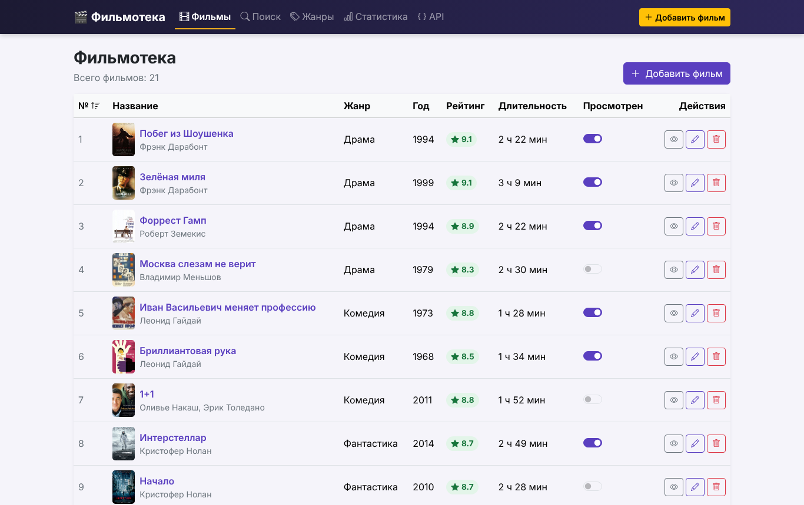 Главная: список фильмов | 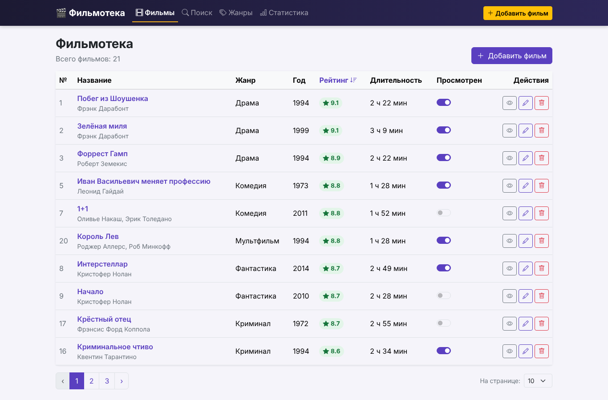 Сортировка по рейтингу |
| 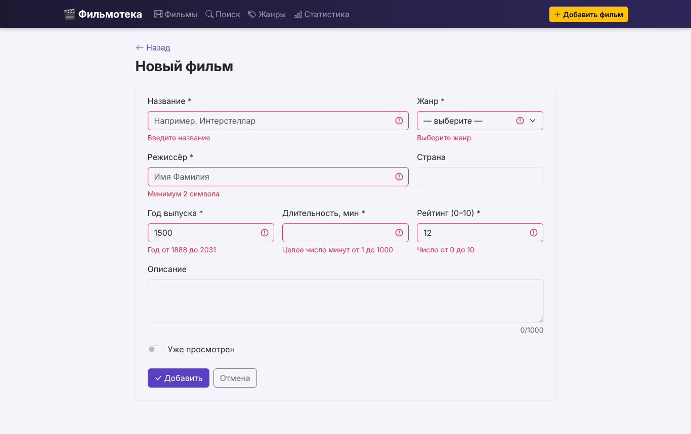 Проверка формы | 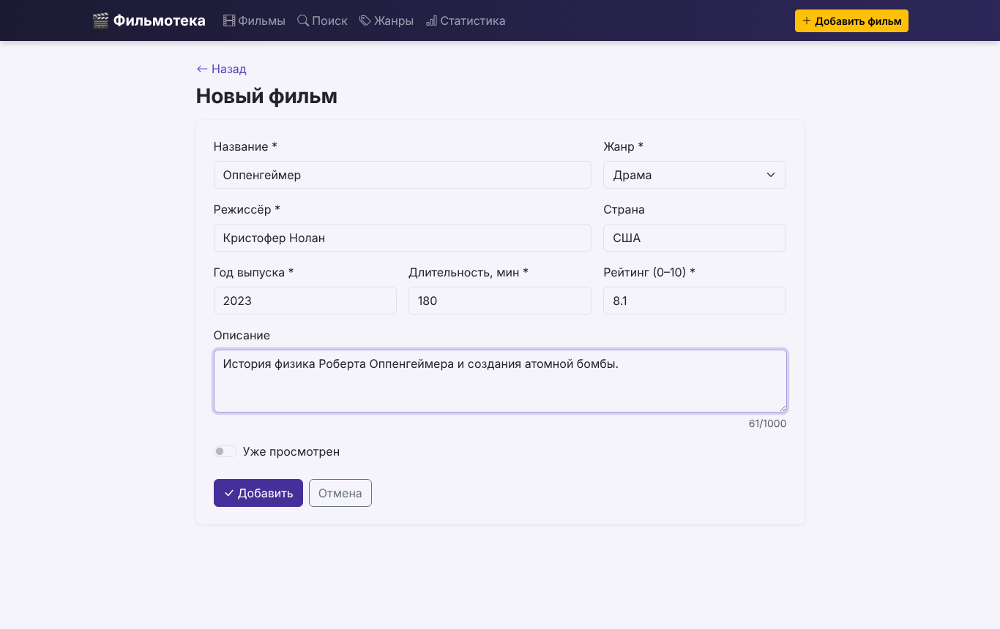 Добавление фильма |
| 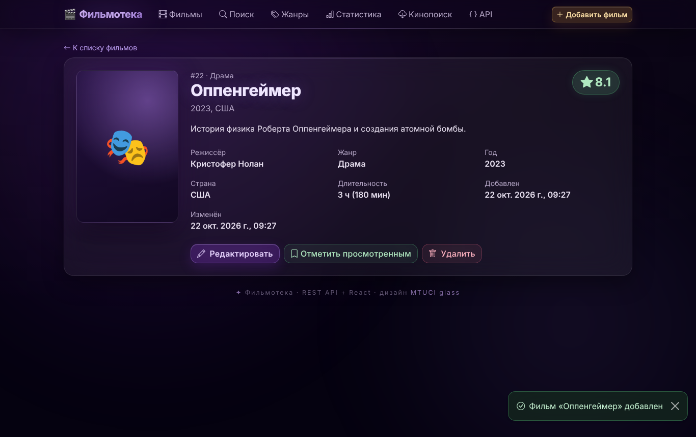 Фильм добавлен | 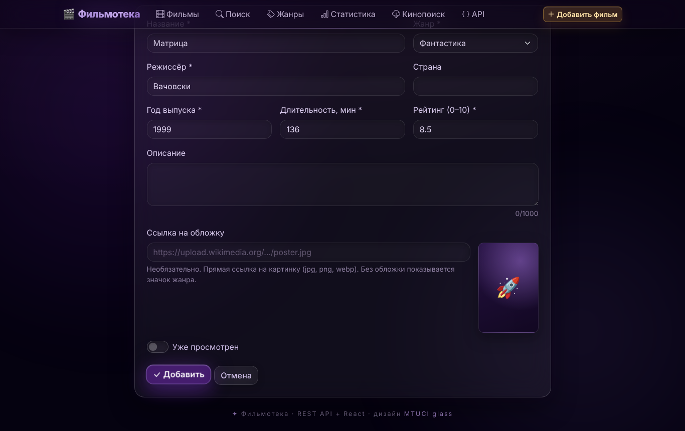 Ошибка сервера: дубликат |
| 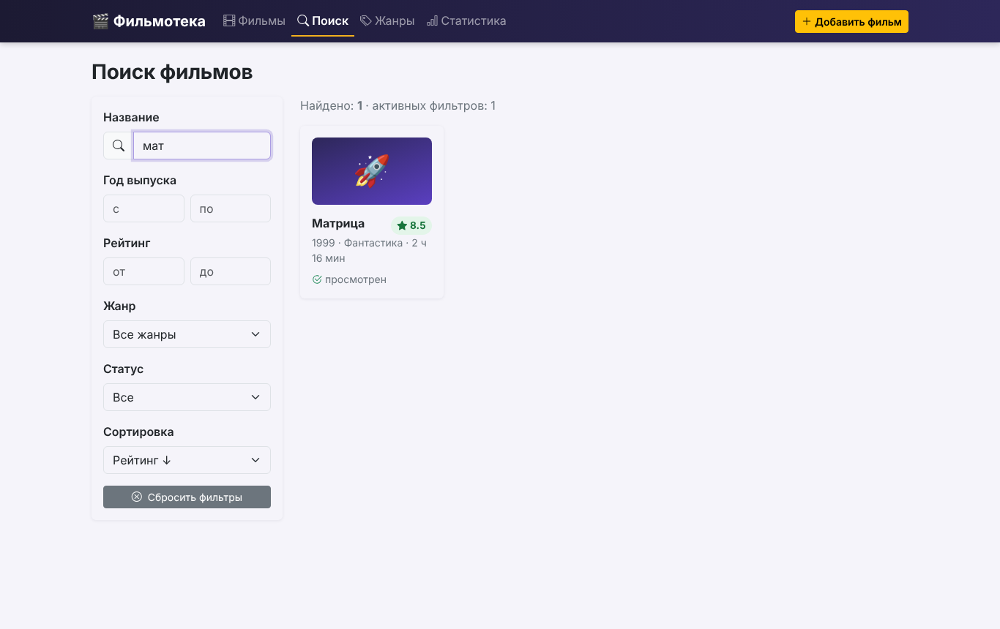 Поиск по названию | 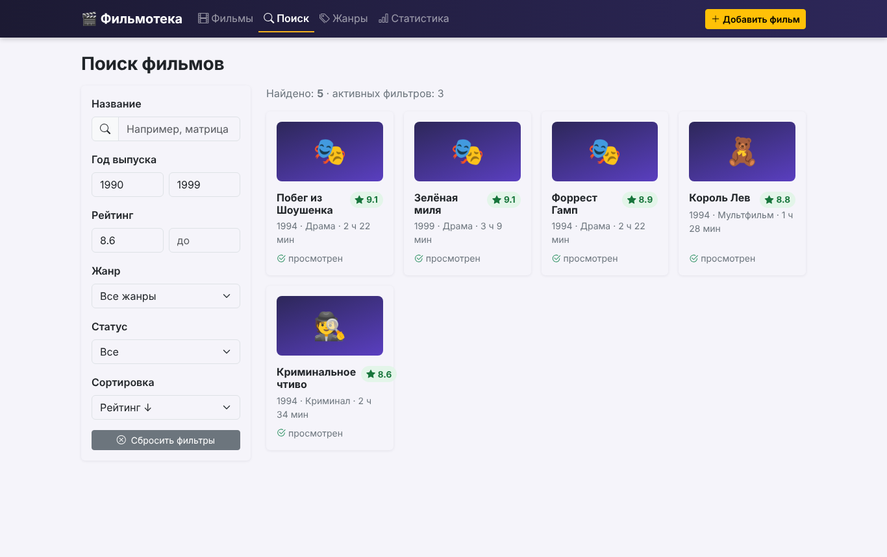 Фильтр по году и рейтингу |
| 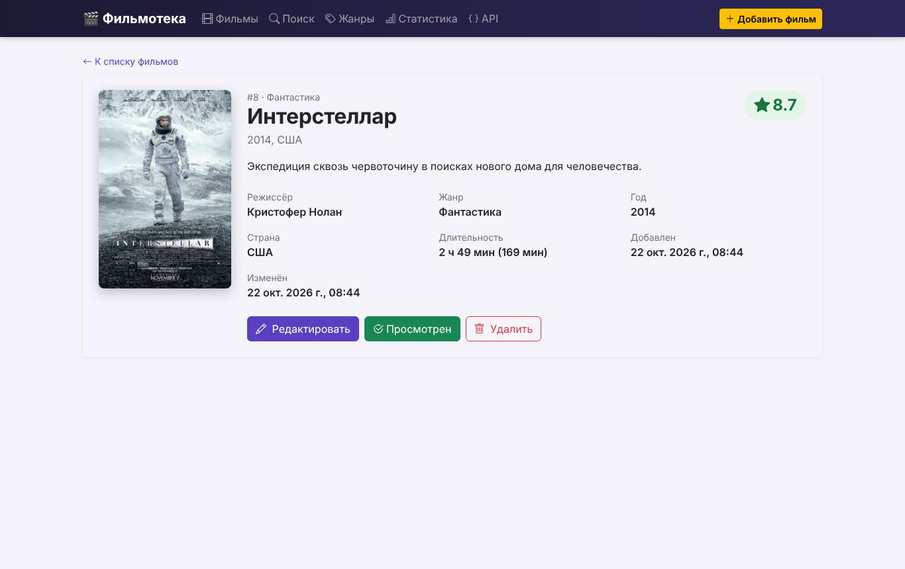 Детали фильма с обложкой | 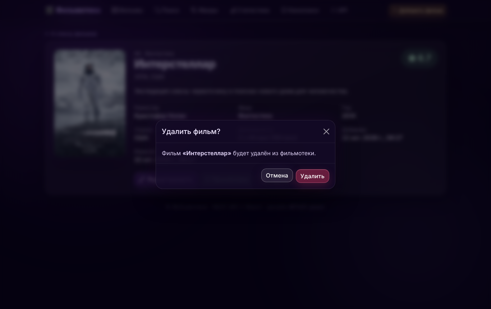 Подтверждение удаления |
| 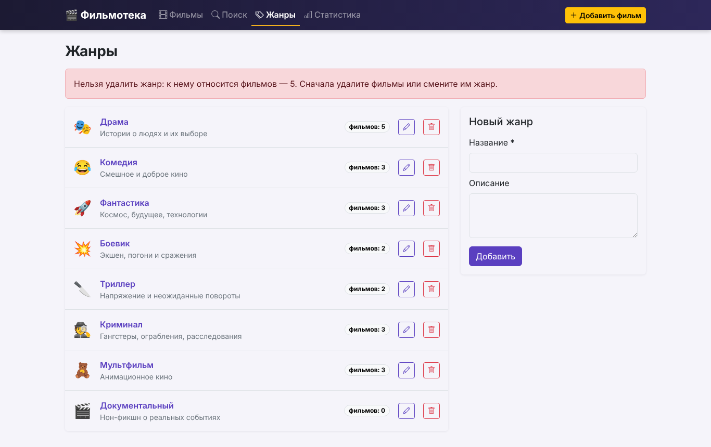 Жанры | 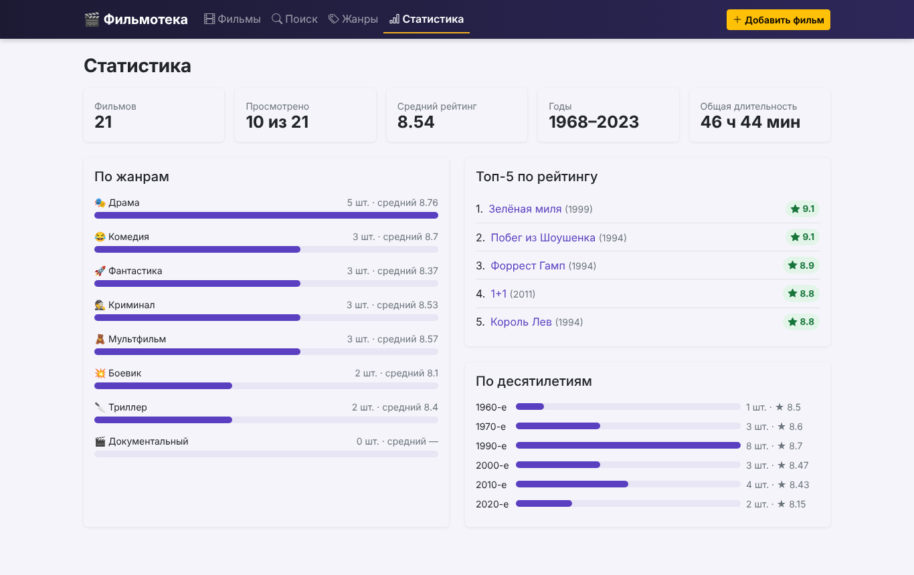 Статистика |
| 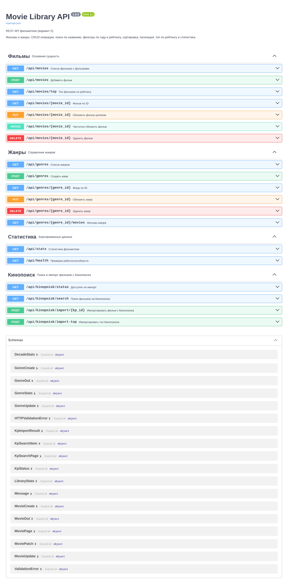 Swagger UI | 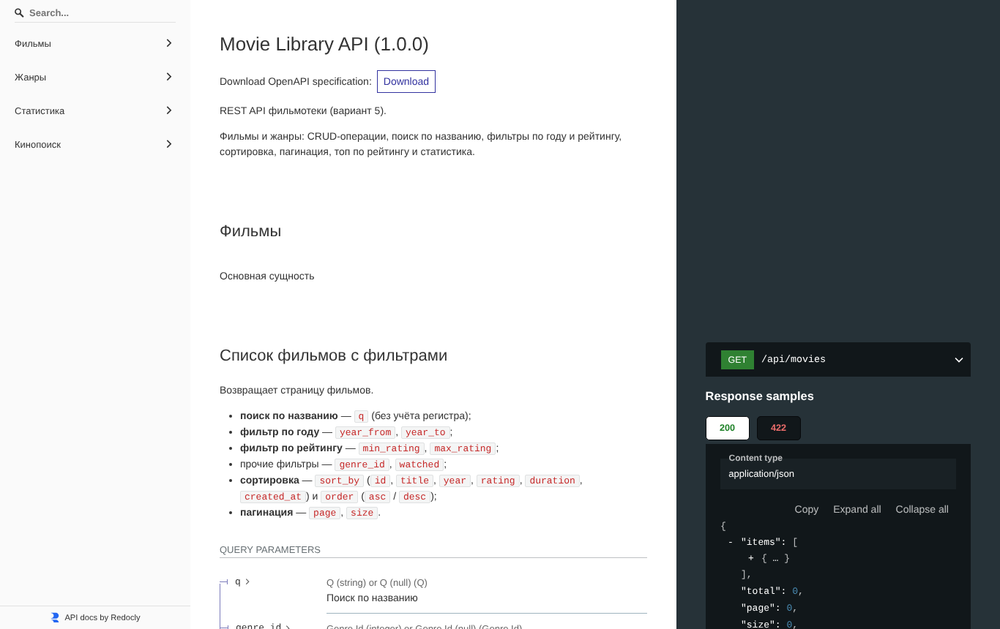 ReDoc |
